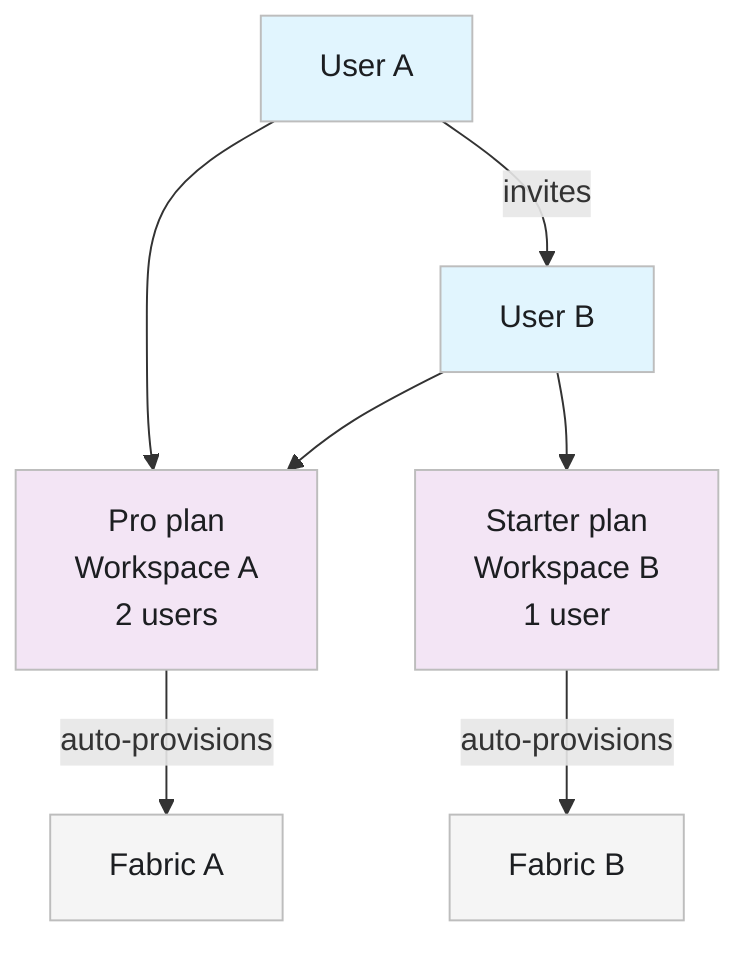

Prophecy billing is determined by edition. Self-serve billing is available for the free Starter plan and the Professional Edition (Pro plan). Express and Enterprise Editions are managed through external purchase channels.

| Edition      | Billing           |
| ------------ | ----------------- |
| Starter (free) | Stripe          |
| Professional | Stripe            |
| Express      | Cloud Marketplace |
| Enterprise   | Purchase Order    |

## Starter and Professional Editions

The Starter plan and the Professional Edition use a credit-based billing model managed through Stripe.

- **Starter**: Free. Includes 5 credits per month for a single user.
- **Pro**: Includes 50 credits per user per month. Included credits reset each month and don't roll over. Extra usage is pay-as-you-go unless you pause it.

### Plan-workspace relationship

Each plan is associated with a single workspace. The user who created the workspace is its billing admin and is the only user who can change the workspace's spending settings, payment method, or plan.

Review the following example:

1. An existing user (User A) invites a new user (User B) to their workspace.

1. User B signs up for Prophecy and joins User A's workspace.

1. User B also receives their own personal workspace on the Starter plan, where they are the billing admin.

   They can choose to upgrade this workspace to the Pro plan.

This model ensures that users can have separate personal workspaces with independent plans.

The flow is illustrated below:

### Billing page

The **Billing** page shows the plan, credit usage, and spending settings for your current workspace.

To open the Billing page, open **Settings** and select **Billing** under **Workspace**. You can also click **View more** under **Credit Usage** in your profile menu. To view another workspace's billing, switch workspaces from the **Workspaces** list in your profile menu.

The Billing page includes:

| Section | Description |
| ------- | ----------- |
| Current plan | Your plan and when it renews. |
| Monthly Credits Usage | Credits used this month, split into included and additional credits, and when usage resets. |
| Workspace members | The number of users in the workspace and the price per user. Pro plan only. |
| Additional Usage | The cost of usage beyond your included credits, your usage alert and budget, or **Paused** if additional usage is paused. Shows **Outstanding Balance** when the workspace owes money. |
| Payment method | The card on file. Pro plan only. |
| Credit usage | A bar that shows credit usage by category (AI requests, compute, data egressed, and data storage), with markers for your alerts and budget. Expand **View detailed resource usage** for a breakdown. |
| All plans | The available plans and the actions you can take on each. |

<Info>
  For information about how credits are consumed, see
  [Credits](/administration/management/usage-billing/credits).
</Info>

### Manage monthly spending

On the Pro plan, the billing admin can limit seats, get alerts, and choose what happens when included credits run out.

1. Open the **Billing** page.
1. In the **Credit usage** section, click **Manage monthly spending**.
1. Configure the settings described below.
1. Click **Save**.

| Setting | Description |
| ------- | ----------- |
| Team seats | Turn on **Limit seats to** and enter the maximum number of users the workspace can have. The limit can't be lower than the current number of users. |
| Included credits | Turn on **Alert me at** and enter a percentage of your included credits. You're alerted when usage reaches it. The default is 80%. |
| Additional usage | Choose what happens when included credits run out: <ul><li>**Pause services**: Stop when included credits run out. There are no extra charges.</li><li>**Continue with pay-as-you-go** (default): Keep working and pay per credit for extra usage. Optionally, set a **Budget**, where services pause, and an **Alert at** value, which only sends an alert. Enter them in credits or dollars. Leave a field empty for no limit.</li></ul> |

The budget and alert apply only to usage beyond your included credits. When the workspace reaches an alert, the billing admin receives an email and users see an alert in Prophecy. When services pause because included credits ran out or the budget was reached, Prophecy shows a banner. The billing admin can switch to pay-as-you-go or increase the budget to continue.

<Tip>
  Review these settings when you first upgrade to the Pro plan, and update them if needed.
</Tip>

### Update payment method

To update your payment method:

1. Open the **Billing** page.
1. Under **Payment method**, click **Manage**.
1. Follow the instructions in Stripe to update your payment method.

### Upgrade plan

To upgrade from the Starter plan to the Pro plan:

1. Switch to the workspace you want to upgrade.
1. Open the **Billing** page.
1. In **All plans**, click **Upgrade now** on the **Pro** card.

You will be taken to Stripe for payment.

### Downgrade or cancel

To downgrade from the Pro plan to the Starter plan, the billing admin clicks **Switch to Starter** on the **Starter** card in **All plans**. To cancel instead, click **Cancel Subscription** on the **Pro** card.

Both actions send a request to Prophecy. After you confirm, Prophecy contacts you with the next steps.

## Express Edition

Express Edition is billed through the cloud marketplace (AWS or Azure) where the deployment was initialized. Billing and invoicing are handled by the marketplace provider, and details are available through their respective dashboards.

## Enterprise Edition

Enterprise Edition is billed through purchase orders. Invoicing, contracts, and terms are managed directly between Prophecy and your organization. Billing information is not available in the Prophecy UI.

<Note>
  To upgrade to the Enterprise Edition, you must [contact us](https://www.prophecy.io/contact-us).
  You won't be able to upgrade independently.
</Note>
