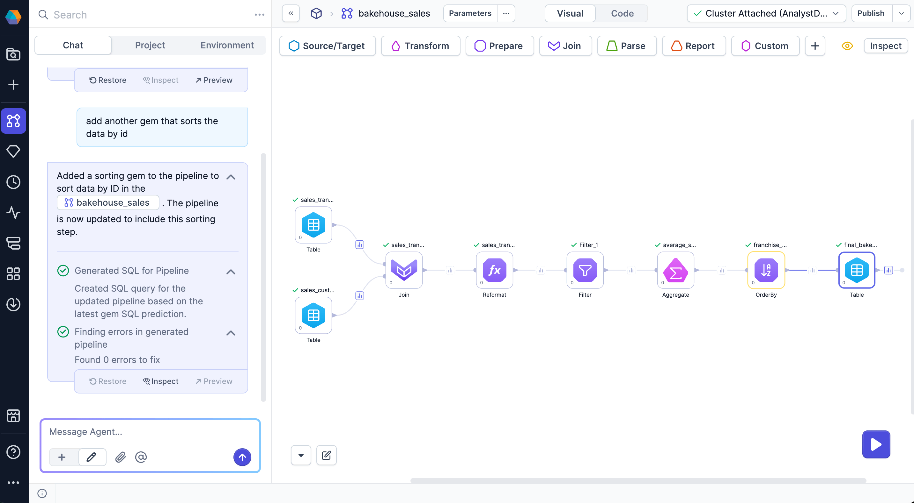

You can use the Prophecy Agent to generate transformations based on natural language prompts. When you describe a data operation, the Transform Agent generates the corresponding gems in the pipeline and summarizes the applied changes in the chat interface.

The following sections describe how to add transformations, review the changes, and undo them.

The Transform Agent is available when **Enable Conversational Agents** is turned on for your team. See [AI settings](/administration/management/teams/settings/ai).

## What the Transform Agent can modify

The Transform Agent operates strictly within the active [project](/data-analysis/development/projects/create-project). It can:

- Create and refactor pipelines.
- Generate and update analyses.
- Modify datasets and related project artifacts.
- Update project documentation.
- In the Free and Professional Editions, browse, read, organize, upload, and delete files in the fabric's [DataBox](/data-analysis/getting-started/datagpt/files).

All changes remain fully visible and editable in the project editor.

## Execution model

The Transform Agent can retrieve metadata and limited data samples to validate generated transformations.

When executing SQL or running pipelines, the Agent operates under the permissions of the user who invoked it.

Before the Agent runs a query that writes or changes data, or runs a pipeline that writes data, it asks you to allow it. Choose **Allow once**, **Always allow** (for the rest of the chat session), or **Deny**. Once allowed, the write takes effect in the connected warehouse under your permissions and can't be undone from the chat. Existing warehouse access controls and governance policies are always enforced.

## Model architecture

The Transform Agent is built on a specialized deployment of Claude Code. By default, it uses Anthropic Claude Opus 5.5.

Prophecy augments model reasoning with structured tool access to project artifacts, metadata, and connected warehouse systems. The model is not used in isolation; all actions are mediated through Prophecy’s execution layer and project boundaries.

Enterprise customers can configure approved Claude endpoints in supported deployment environments. See [Configure Anthropic endpoint](/administration/management/cluster-admin-settings/configure-endpoint). Using alternative models may affect output quality.

## Prerequisites

You need at least one [Source gem](/data-analysis/gems/source-target/source-target) in your pipeline to add transformation gems with AI chat.

## Provide a transformation

To generate a transformation, enter a prompt that describes the desired data operation.

The Agent returns:

- One or more gems on the pipeline canvas.
- A description of the applied changes.
- **Review changes**, **Undo**, and **Rollback** actions for the changes in the response.
- A group of SQL execution logs.

## Review pipeline changes

To step through the changes the Agent made:

1. Click **Review changes** on the response that made the changes. Prophecy opens review mode.
1. Review the first changed gem. On the canvas, gems the Agent added are outlined in green (**Added by AI**), and gems it edited are outlined in yellow (**Edited by AI**).
1. Use the previous and next arrows in the review bar to move through the other changed gems. The bar shows your position, such as `Reviewing 1 of 3 gems modified by AI`.
1. Examine both the input and output of each gem to confirm that the transformation produces the expected result.
1. Click **Exit review mode** when you're done.

## Undo changes

To revert the Agent's changes:

- Click **Undo** on the most recent response to revert the changes from that response.
- Click **Rollback** on an earlier response to restore the project to its state before that response. Changes from later responses are reverted too.

Both actions ask you to confirm. See [Undo or roll back AI changes](/data-analysis/ai/agent/chat/using-chat#undo-or-roll-back-ai-changes). You can also manage versions from the project [version history](/data-analysis/development/versioning/version-control).

## Create output tables

After adding various data transformations in your pipeline, ask the Agent to save the result as a table. The Agent writes the output to the default database and schema configured for your connected fabric. This allows you to persist results and reuse them in downstream workflows.

<Warning>
  If you have multiple pipelines or pipeline branches that do not terminate with tables, the Agent
  will not be able to create an output table.
</Warning>

## Project history

All changes made by the Agent are saved in the project [version history](/data-analysis/development/versioning/version-control). Commits are clearly marked as authored by the Agent.

<Note>
  If you did not save your project before interacting with the Agent, Prophecy will automatically
  save your changes before the Agent proceeds.
</Note>

## Sample prompts

Here are some sample prompts that can produce transformations in your pipeline.

| Scenario           | Prompt                                                    | Expected output   |
| ------------------ | --------------------------------------------------------- | ----------------- |
| Filter records     | "Filter to only include customers from California"        | Filter gem        |
| Add transformation | "Calculate the total order value as `quantity * price`"   | Reformat gem      |
| Clean data         | "Remove rows where email is null"                         | DataCleansing gem |
| Aggregate data     | "Group by region and calculate average sales"             | Aggregate gem     |
| Rename columns     | "Rename `cust_id` to `customer_id` and `amt` to `amount`" | Reformat gem      |
| Save output tables | "Show me and save the final output of the pipeline"       | Table gem         |
