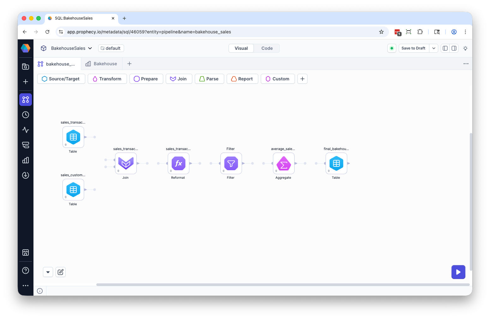
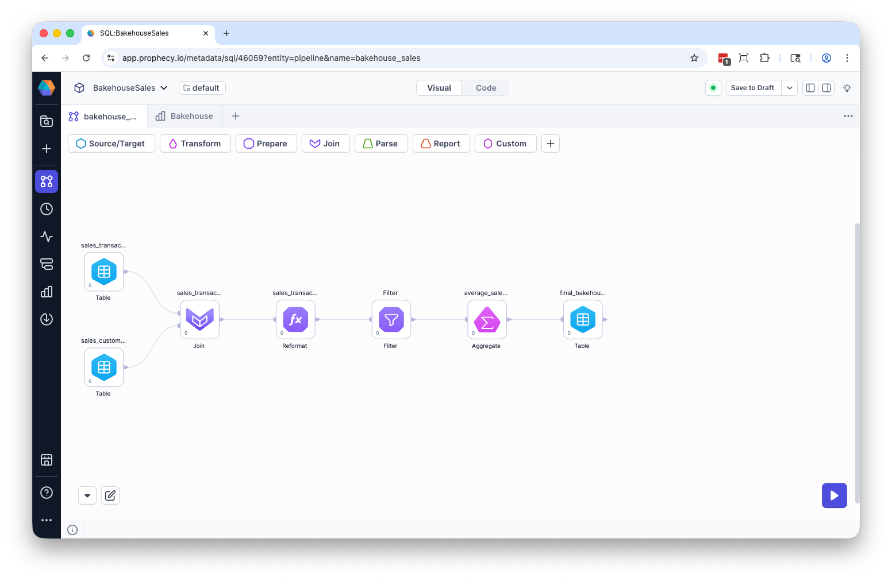

Wireless connections let you hide visual lines between gems on the canvas while retaining the logical connection between gems.

This option lets you reduce visual clutter, making large or evolving pipelines easier to read.

Wireless connections affect only the canvas presentation. They do not change execution order, data dependencies, or runtime behavior.

## Make connections wireless

You can convert wired connections into wireless ones from a gem's [action menu](/data-analysis/gems/gems#action-menu).

To make a gem's connections wireless:

1. Click the gem whose connections you want to modify.
1. Open the gem's action menu (`...`).
1. Select one of the following options:

   - **Make Incoming Connections Wireless**: Makes all of the gem's incoming connections wireless.
   - **Make Outgoing Connections Wireless**: Makes all of the gem's outgoing connections wireless.

The visual line disappears, but the data flow between the gems is preserved.

To change specific connections instead, select one or more connection lines on the canvas. Then click **Actions** at the bottom of the canvas and select **Make Connection Wireless** (or **Make Connections Wireless** for more than one).

## Restore wired connections

To restore visual connections:

1. Click the gem with wireless connections.
1. Open the gem's action menu (`...`).
1. Select one of the following options:

   - **Make Incoming Connections Wired**
   - **Make Outgoing Connections Wired**

   These options appear when all of the gem's connections in that direction are already wireless.

To restore specific connections, select them and choose **Make Connection Wired** from the **Actions** menu.

The visual connection lines are restored.

## When to use wireless connections

Wireless connections are most effective when:

- Pipelines contain many parallel branches or long cross-canvas connections.
- You want to reorganize or refactor a pipeline without rearranging large sections of the canvas.
- Visual clarity is more important than showing every physical connection.
